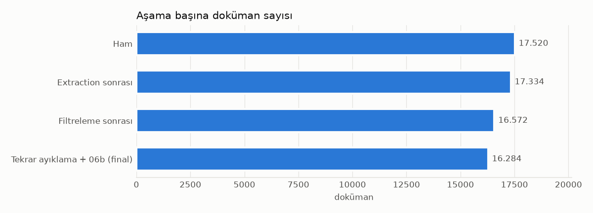
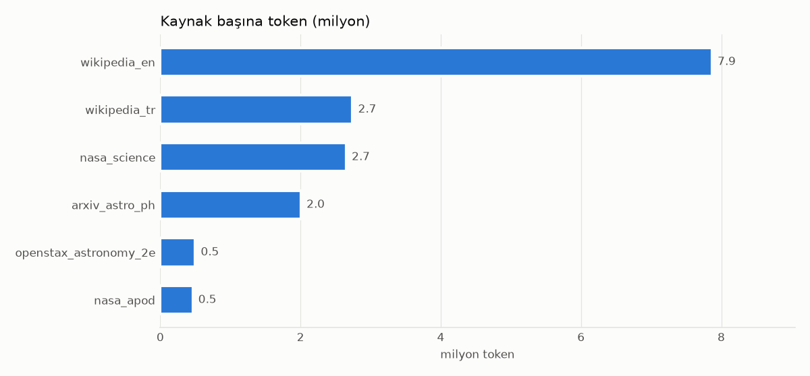
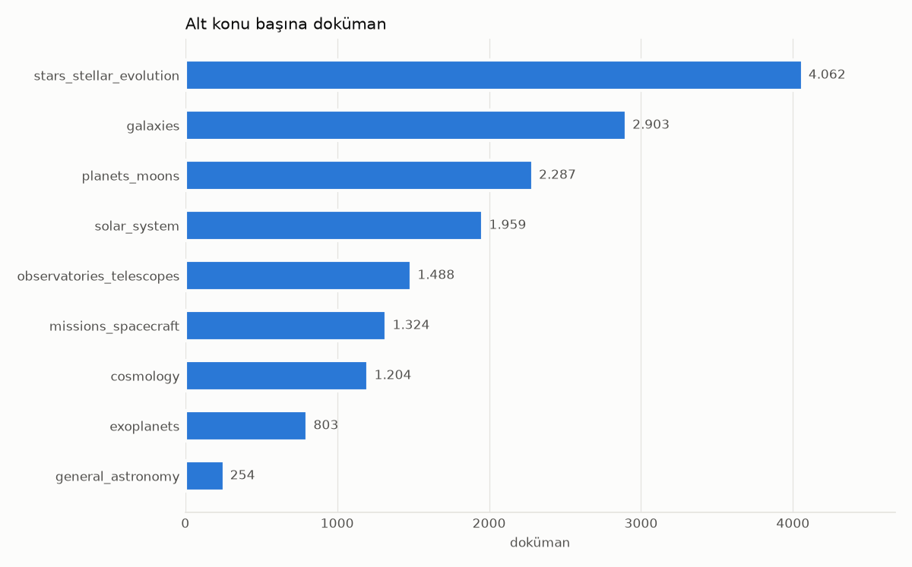
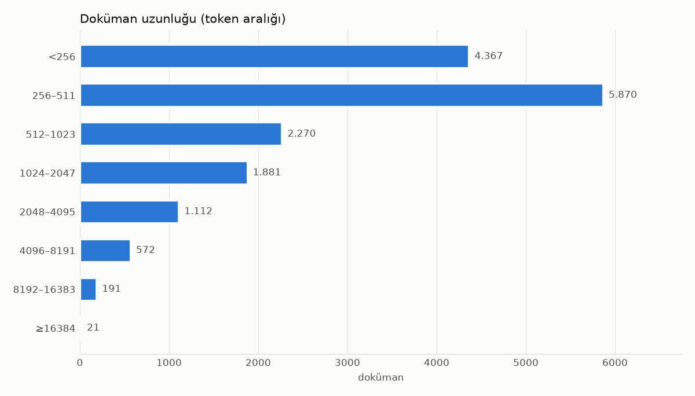

# Domain Corpus v1.0 — İstatistik Raporu

Bu rapor `scripts/08_statistics.py` tarafından üretilir; elle düzenlenmez.

## 1. Sayısal özet

| Özellik | Değer |
| --- | --- |
| Veri kaynağı sayısı (corpus) | 6 |
| Ham doküman | 17.520 |
| Extraction başarılı | 17.334 |
| Extraction başarısız (indirme hatası + boş/kısa çıktı + içerik dışı PDF bölümü) | 186 (%1,1) |
| Filtering sonrası | 16.572 |
| Exact duplicate | 46 |
| Near duplicate (Jaccard ≥ 0.85) | 90 |
| Yeniden yayın tekrarı (06b; APOD ve NASA Science, kimlik ve kümeler korunarak) | 140 |
| İletişim sayfası, kurgu/eser maddesi, temizlik sonrası çok kısa (06b) | 12 |
| Final doküman | 16.284 |
| Toplam kelime | 10.494.610 |
| Toplam token (Qwen/Qwen2.5-7B) | 16.231.969 |
| İngilizce içerik (token) | %83,1 |
| Türkçe içerik (token) | %16,9 |
| Manuel kontrol örneği (corpus) | 100 |
| Manuel kalite başarısı (corpus) | %88,0 |
| Instruction örneği | 3.340 |
| Instruction kontrol örneği | - |
| Instruction manuel kalite başarısı | - |

## 2. Verinin aşamalar boyunca erimesi

17.520 ham doküman → extraction sonrası 17.334 → temizleme ve filtreleme sonrası 16.572 → tekrar ayıklama ve ikinci geçiş (06b) sonrası **16.284** doküman.

## 3. Çıkarılma nedenleri

| Çıkarma nedeni | Doküman | Aşama |
| --- | --- | --- |
| out_of_domain_category | 356 | filter |
| too_short | 242 | filter |
| out_of_domain | 150 | filter |
| repost_duplicate | 140 | dedup2 |
| non_content_section | 135 | extraction |
| near_duplicate | 90 | dedup |
| extraction_error | 51 | extraction |
| duplicate | 46 | dedup |
| contact_page | 7 | dedup2 |
| wrong_language | 6 | filter |
| reference_list | 5 | filter |
| fiction_work_06b | 4 | dedup2 |
| garbled | 3 | filter |
| too_short_after_06b | 1 | dedup2 |

Ayrıntılı liste: `reports/extraction_failures.csv`, `reports/removed_documents.csv`.

## 4. Kaynak dağılımı (final)

| Kaynak | Dil | Doküman | Kelime | Token | Token payı |
| --- | --- | --- | --- | --- | --- |
| wikipedia_en | en | 3.238 | 5.436.213 | 7.868.683 | %48,5 |
| wikipedia_tr | tr | 1.561 | 1.024.725 | 2.742.435 | %16,9 |
| nasa_science | en | 2.849 | 1.947.218 | 2.651.697 | %16,3 |
| arxiv_astro_ph | en | 5.953 | 1.330.311 | 2.007.161 | %12,4 |
| openstax_astronomy_2e | en | 238 | 394.967 | 498.952 | %3,1 |
| nasa_apod | en | 2.445 | 361.176 | 463.041 | %2,9 |

En büyük kaynağın doküman payı: %36,6 (tek kaynak baskın değil).

## 5. Alt konu dağılımı

| Alt konu | Doküman | Doküman payı | Token payı |
| --- | --- | --- | --- |
| stars_stellar_evolution | 4.062 | %24,9 | %23,7 |
| galaxies | 2.903 | %17,8 | %9,8 |
| planets_moons | 2.287 | %14,0 | %17,0 |
| solar_system | 1.959 | %12,0 | %16,4 |
| observatories_telescopes | 1.488 | %9,1 | %10,9 |
| missions_spacecraft | 1.324 | %8,1 | %10,3 |
| cosmology | 1.204 | %7,4 | %7,5 |
| exoplanets | 803 | %4,9 | %3,6 |
| general_astronomy | 254 | %1,6 | %0,7 |

## 6. Dil dağılımı

| Dil | Doküman | Doküman payı | Token payı |
| --- | --- | --- | --- |
| en | 14.723 | %90,4 | %83,1 |
| tr | 1.561 | %9,6 | %16,9 |

## 7. Doküman türleri

| Tür | Doküman |
| --- | --- |
| makale_ozeti | 5.953 |
| ansiklopedi_maddesi | 4.799 |
| apod_aciklama | 2.445 |
| web_makale | 1.555 |
| gorev_sayfasi | 1.163 |
| ders_kitabi | 183 |
| egitim_sayfasi | 108 |
| ders_kitabi_ozet | 55 |
| sozluk | 23 |

## 8. Token uzunluk dağılımı (doküman başına)

| Küme | Doküman | Toplam token | Min | Medyan | Ortalama | p95 | Maks |
| --- | --- | --- | --- | --- | --- | --- | --- |
| Tümü | 16.284 | 16.231.969 | 53 | 391 | 996.8 | 3.978 | 57.979 |
| train | 14.660 | 14.798.649 | 53 | 391 | 1009.5 | 4.039 | 57.979 |
| validation | 819 | 737.348 | 65 | 393 | 900.3 | 3.342 | 11.538 |
| test | 805 | 695.972 | 58 | 396 | 864.6 | 3.299 | 15.770 |

| Kaynak | Min | Medyan | Ortalama | p95 | Maks |
| --- | --- | --- | --- | --- | --- |
| arxiv_astro_ph | 53 | 343 | 337.2 | 493 | 703 |
| nasa_apod | 73 | 187 | 189.4 | 257 | 348 |
| nasa_science | 55 | 700 | 930.7 | 2.280 | 57.979 |
| openstax_astronomy_2e | 73 | 1.800 | 2096.4 | 5.219 | 6.747 |
| wikipedia_en | 70 | 1.566 | 2430.1 | 7.640 | 27.769 |
| wikipedia_tr | 91 | 722 | 1756.8 | 7.055 | 25.286 |

Chunk'lar (en fazla 1024 token, paragraf/başlık sınırında): 33.997 chunk, medyan 396, p95 982 token.

## 9. Veri ayrımı (doküman düzeyinde)

| Küme | Doküman | Oran |
| --- | --- | --- |
| train | 14.660 | %90,0 |
| validation | 819 | %5,0 |
| test | 805 | %4,9 |

Seed 42; kaynak bazında tabakalı; Wikipedia EN/TR aynı madde (Wikidata QID) aynı kümede. Kümeler arası grup çakışması: 0 (`scripts/validate_datasets.py`).

## 10. Yayın / son düzenleme yılı

| Yıl aralığı | Doküman |
| --- | --- |
| 1990–2004 | 938 |
| 2005–2014 | 1.090 |
| 2015–2019 | 1.156 |
| 2020–2023 | 1.380 |
| 2024–2026 | 11.719 |
| bilinmiyor | 1 |
