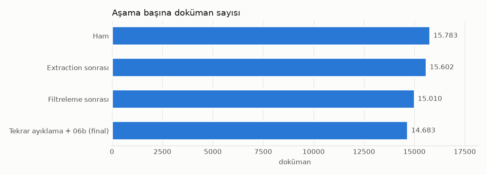
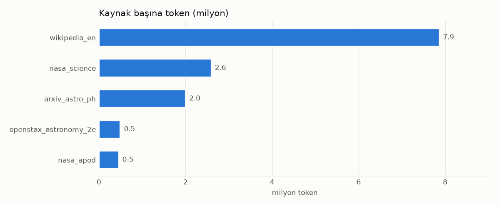
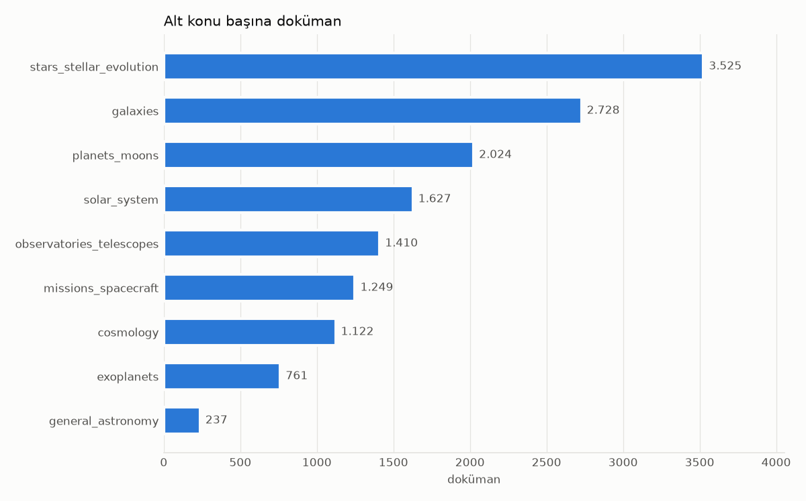
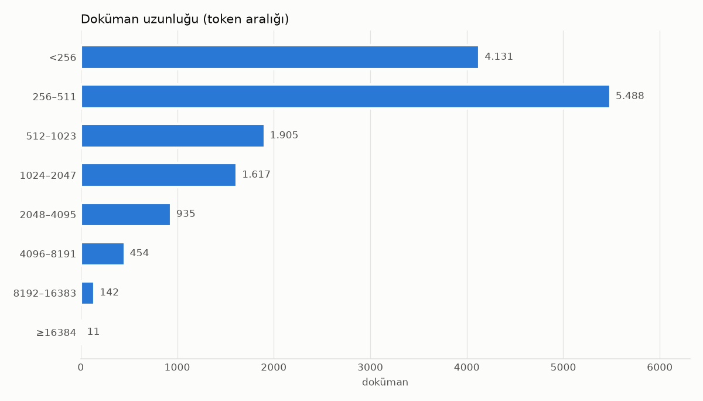

# Domain Corpus v2.0 — İstatistik Raporu

Bu rapor `scripts/08_statistics.py` tarafından üretilir; elle düzenlenmez.

## 1. Sayısal özet

| Özellik | Değer |
| --- | --- |
| Veri kaynağı sayısı (corpus) | 5 |
| Ham doküman | 15.783 |
| Extraction başarılı | 15.602 |
| Extraction başarısız (indirme hatası + boş/kısa çıktı + içerik dışı PDF bölümü) | 181 (%1,1) |
| Filtering sonrası | 15.010 |
| Exact duplicate | 46 |
| Near duplicate (Jaccard ≥ 0,85) | 90 |
| Yeniden yayın tekrarı (06b; APOD ve NASA Science, kimlik ve kümeler korunarak) | 140 |
| İletişim sayfası, kurgu/eser maddesi, liste/haber sayfası, temizlik sonrası çok kısa (06b) | 51 |
| Final doküman | 14.683 |
| Toplam kelime | 9.440.259 |
| Toplam token (Qwen/Qwen2.5-7B) | 13.438.685 |
| İngilizce içerik (token) | %100,0 |
| Manuel kontrol örneği (corpus) | 100 |
| Manuel kalite başarısı (corpus) | %89,0 |
| Instruction örneği | - |
| Instruction kontrol örneği | - |
| Instruction manuel kalite başarısı | - |

## 2. Verinin aşamalar boyunca erimesi

15.783 ham doküman → extraction sonrası 15.602 → temizleme ve filtreleme sonrası 15.010 → tekrar ayıklama ve ikinci geçiş (06b) sonrası **14.683** doküman.

## 3. Çıkarılma nedenleri

| Çıkarma nedeni | Doküman | Aşama |
| --- | --- | --- |
| out_of_domain_category | 272 | filter |
| too_short | 183 | filter |
| repost_duplicate | 140 | dedup2 |
| non_content_section | 135 | extraction |
| out_of_domain | 123 | filter |
| near_duplicate | 90 | dedup |
| extraction_error | 46 | extraction |
| duplicate | 46 | dedup |
| list_page_06b | 38 | dedup2 |
| contact_page | 7 | dedup2 |
| wrong_language | 6 | filter |
| reference_list | 5 | filter |
| garbled | 3 | filter |
| too_short_after_06b | 3 | dedup2 |
| fiction_work_06b | 3 | dedup2 |

Ayrıntılı liste: `reports/extraction_failures.csv`, `reports/removed_documents.csv`.

## 4. Kaynak dağılımı (final)

| Kaynak | Dil | Doküman | Kelime | Token | Token payı |
| --- | --- | --- | --- | --- | --- |
| wikipedia_en | en | 3.238 | 5.436.213 | 7.868.683 | %58,6 |
| nasa_science | en | 2.809 | 1.917.671 | 2.600.395 | %19,4 |
| arxiv_astro_ph | en | 5.953 | 1.330.311 | 2.007.161 | %14,9 |
| openstax_astronomy_2e | en | 238 | 394.918 | 499.554 | %3,7 |
| nasa_apod | en | 2.445 | 361.146 | 462.892 | %3,4 |

En büyük kaynağın doküman payı: %40,5 (tek kaynak baskın değil).

## 5. Alt konu dağılımı

| Alt konu | Doküman | Doküman payı | Token payı |
| --- | --- | --- | --- |
| stars_stellar_evolution | 3.525 | %24,0 | %22,5 |
| galaxies | 2.728 | %18,6 | %10,2 |
| planets_moons | 2.024 | %13,8 | %17,2 |
| solar_system | 1.627 | %11,1 | %15,0 |
| observatories_telescopes | 1.410 | %9,6 | %11,8 |
| missions_spacecraft | 1.249 | %8,5 | %11,4 |
| cosmology | 1.122 | %7,6 | %7,1 |
| exoplanets | 761 | %5,2 | %4,1 |
| general_astronomy | 237 | %1,6 | %0,7 |

## 6. Dil dağılımı

| Dil | Doküman | Doküman payı | Token payı |
| --- | --- | --- | --- |
| en | 14.683 | %100,0 | %100,0 |

## 7. Doküman türleri

| Tür | Doküman |
| --- | --- |
| makale_ozeti | 5.953 |
| ansiklopedi_maddesi | 3.238 |
| apod_aciklama | 2.445 |
| web_makale | 1.540 |
| gorev_sayfasi | 1.144 |
| ders_kitabi | 183 |
| egitim_sayfasi | 102 |
| ders_kitabi_ozet | 55 |
| sozluk | 23 |

## 8. Token uzunluk dağılımı (doküman başına)

| Küme | Doküman | Toplam token | Min | Medyan | Ortalama | p95 | Maks |
| --- | --- | --- | --- | --- | --- | --- | --- |
| Tümü | 14.683 | 13.438.685 | 53 | 379 | 915,3 | 3.593 | 57.979 |
| train | 13.223 | 12.193.842 | 53 | 379 | 922,2 | 3.633 | 57.979 |
| validation | 735 | 639.605 | 65 | 379 | 870,2 | 3.342 | 11.538 |
| test | 725 | 605.238 | 58 | 385 | 834,8 | 3.112 | 15.770 |

| Kaynak | Min | Medyan | Ortalama | p95 | Maks |
| --- | --- | --- | --- | --- | --- |
| arxiv_astro_ph | 53 | 343 | 337,2 | 493 | 703 |
| nasa_apod | 73 | 187 | 189,3 | 257 | 348 |
| nasa_science | 55 | 701 | 925,7 | 2.245 | 57.979 |
| openstax_astronomy_2e | 68 | 1.800 | 2.099,0 | 5.219 | 6.747 |
| wikipedia_en | 70 | 1.566 | 2.430,1 | 7.640 | 27.769 |

Chunk'lar (en fazla 1024 token, paragraf/başlık sınırında): 29.070 chunk, medyan 383, p95 980 token.

## 9. Veri ayrımı (doküman düzeyinde)

| Küme | Doküman | Oran |
| --- | --- | --- |
| train | 13.223 | %90,1 |
| validation | 735 | %5,0 |
| test | 725 | %4,9 |

Seed 42; kaynak bazında tabakalı; gruplama anahtarı Wikidata QID (aynı maddenin sürümleri aynı kümede). Kümeler arası grup çakışması: 0 (`scripts/validate_datasets.py`).

## 10. Yayın / son düzenleme yılı

| Yıl aralığı | Doküman |
| --- | --- |
| 1990–2004 | 938 |
| 2005–2014 | 1.088 |
| 2015–2019 | 1.153 |
| 2020–2023 | 1.351 |
| 2024–2026 | 10.153 |
| bilinmiyor | 0 |
